# LogiSync v2.0 — Enterprise AWS Cloud Deployment Architecture

> **Official Cloud Architecture Specification & Academic Defense Dossier**  
> **Project:** LogiSync v2.0 — Port Logistics Command Center (V.O. Chidambaranar Port, Thoothukudi)  
> **Target Cloud:** Amazon Web Services (AWS)  
> **Primary Region:** `ap-south-1` (Mumbai, India)  
> **Credit Budget:** $101.00 USD AWS Educational Credits (~$35/month runtime cost)  
> **Architectural Pattern:** Multi-AZ 3-Tier Enterprise Cloud Architecture (Decoupled Compute, Storage, Event-Driven Messaging & Identity)

---

## 1. High-Level Architecture Overview

LogiSync is engineered as a **Cloud-Native, High-Availability (HA), Multi-Tier Enterprise Architecture** compliant with the **AWS Well-Architected Framework**. Rather than deploying a brittle monolith on a single compute node, LogiSync decouples presentation, compute, persistent relational data, asynchronous message queuing, notification fan-out, and identity management across isolated AWS Availability Zones (AZs).

```mermaid
flowchart TD
    subgraph Users["End Users, Dispatchers & Freight Fleets"]
        BROWSER["Desktop / Mobile Client (Command Center)"]
        MOBILE["Truck Drivers (SMS / Mobile Web)"]
    end

    subgraph Edge["Global Edge Tier (AWS CloudFront, Route 53, WAF)"]
        R53["Amazon Route 53 (DNS Routing)"]
        WAF["AWS WAF (Web Application Firewall)"]
        ACM["AWS Certificate Manager (TLS 1.3 SSL)"]
        CF["Amazon CloudFront CDN (Global Distribution)"]
    end

    subgraph VPC["AWS Virtual Private Cloud (VPC: 10.0.0.0/16) — Region: ap-south-1"]
        IGW["Internet Gateway (IGW)"]

        subgraph PublicSubnets["Public Subnets (AZ-a: 10.0.1.0/24 | AZ-b: 10.0.2.0/24)"]
            ALB["Application Load Balancer (ALB)\n(Dual-AZ Ingress & WebSocket Keep-Alive)"]
            NAT["AWS NAT Gateway\n(Outbound Secure Egress)"]
        end

        subgraph PrivateAppSubnets["Private Application Subnets (AZ-a: 10.0.10.0/24 | AZ-b: 10.0.11.0/24)"]
            subgraph EC2_ASG["Amazon EC2 Auto Scaling Fleet / ECS Fargate"]
                NODE_1["FastAPI Backend Node 1 (AZ-a)\n(Port 8000, Non-Root)"]
                NODE_2["FastAPI Backend Node 2 (AZ-b)\n(Port 8000, Non-Root)"]
            end
            AUTOSCALE["EC2 / ECS Auto Scaling Policy\n(CPU & Memory Target Tracking)"]
        end

        subgraph PrivateDBSubnets["Private Database Subnets (AZ-a: 10.0.20.0/24 | AZ-b: 10.0.21.0/24)"]
            RDS_MASTER["Amazon RDS PostgreSQL 16\n(Master Instance)"]
            RDS_STANDBY["RDS PostgreSQL Standby\n(Multi-AZ Synchronous Replication)"]
        end
    end

    subgraph AWS_Managed["AWS Managed Platform & Event Services"]
        subgraph S3_Tier["Amazon S3 Multi-Bucket Tier"]
            S3_WEB["S3 Frontend Bucket\n(React 19 SPA - Private via OAC)"]
            S3_DOCS["S3 Documents Bucket\n(Proof-of-Delivery Photos & Passes)"]
            S3_AUDIT["S3 Audit Bucket\n(Regulatory Compliance Logs + Glacier)"]
        end

        subgraph Queue_Topic["Asynchronous Decoupling Tier"]
            SQS_QUEUE["Amazon SQS Delivery Queue\n(Buffered Telematics & Order Events)"]
            SQS_DLQ["Amazon SQS Dead Letter Queue (DLQ)\n(Failed Event Handling)"]
            SNS_ALERTS["Amazon SNS Topics\n(Alerts, Corridor Bypass, Gate Congestion)"]
        end

        COGNITO["Amazon Cognito User Pool & App Client\n(Role-Based Access Control - RBAC)"]
        CW["Amazon CloudWatch\n(Agent, Custom Metrics, Alarms & Dashboard)"]
        SECRETS["AWS Secrets Manager & SSM\n(Encrypted API Keys & DB Credentials)"]
    end

    %% Edge & Network Ingress
    BROWSER -->|HTTPS :443| R53
    R53 --> CF
    WAF -.-> CF
    CF -->|Static Assets /*| S3_WEB
    CF -->|API Requests /api/* & /ws/*| ALB

    ALB -->|Forward Target Group :8000| NODE_1
    ALB -->|Forward Target Group :8000| NODE_2

    NODE_1 -->|Query & Persist :5432| RDS_MASTER
    NODE_2 -->|Query & Persist :5432| RDS_MASTER
    RDS_MASTER -.->|Synchronous Replication| RDS_STANDBY

    %% Outbound via NAT
    NODE_1 --> NAT
    NODE_2 --> NAT
    NAT --> IGW
    IGW -->|External Geocoding & Maps| MAPS["Google Maps & Geoapify APIs"]

    %% Messaging, Storage & Identity
    NODE_1 -.->|Enqueue Asynchronous Events| SQS_QUEUE
    SQS_QUEUE -.->|Retries Failed Events| SQS_DLQ
    NODE_1 -.->|Publish Emergency Alerts| SNS_ALERTS
    SNS_ALERTS -->|Direct SMS Alerts| MOBILE
    NODE_1 -.->|Upload POD & Gate Passes| S3_DOCS
    NODE_1 -.->|Archive Trace Records| S3_AUDIT
    NODE_1 -.->|Emit Custom Telematics Metrics| CW
    BROWSER -->|Authenticate & Receive JWT| COGNITO
    NODE_1 -->|Verify JWT via JWKS| COGNITO
    NODE_1 -.->|Retrieve Dynamic Config| SECRETS
    AUTOSCALE -.->|Scale Out / In| EC2_ASG
```

---

## 2. Comprehensive Catalog of All 15 AWS Services Used

| # | AWS Service | Architecture Layer | Concrete Implementation in LogiSync | Evaluator Justification |
| :---: | :--- | :--- | :--- | :--- |
| **1** | **Amazon EC2** *(Elastic Compute Cloud)* | Application Compute | Scalable compute fleet configured with an **Auto Scaling Group (ASG)** and **Launch Template** spanning multiple AZs. Hosts the FastAPI backend under unprivileged user isolation. | Eliminates single-server failure; auto-heals crashed instances; dynamically handles freight spikes. |
| **2** | **Amazon S3** *(Simple Storage Service)* | Object Storage | **Three dedicated buckets**: (1) Static SPA hosting behind CloudFront OAC, (2) Proof-of-Delivery (POD) photos and e-gate pass waybills, (3) Encrypted audit logs with automated **S3 Glacier lifecycle transitions**. | 99.999999999% (11 9s) durability, zero server storage overhead, compliant regulatory archiving. |
| **3** | **Amazon Cognito** | Identity & Access | **User Pool** with email verification and custom attribute `custom:role` (`port_admin`, `fleet_manager`, `dispatcher`, `driver`, `consumer`). **App Client** configured for secret-less Single Page App flow. | No plaintext or hashed passwords stored in application DB; brute-force protection; cryptographic RS256 JWT validation. |
| **4** | **Amazon CloudWatch** | Observability & Ops | (1) CloudWatch Logs for structured JSON access logs, (2) CloudWatch Agent for EC2 RAM/Disk metrics, (3) Custom Namespace `LogiSync/PortLogistics` (`GateCongestionScore`, `ActiveBookings`), (4) Automated metric alarms, (5) Central Executive Dashboard. | Instant MTTR visibility; automated alarms alert engineers when gate dwell indices spike. |
| **5** | **Amazon SNS** *(Simple Notification Service)* | Decoupled Messaging | Three dedicated topics: `logisync-alerts`, `logisync-reroute`, `logisync-congestion`. Integrates with **Direct SMS** to push corridor detour recommendations directly to freight drivers' mobile phones. | Decouples alert fan-out from synchronous HTTP cycles; guarantees rapid broadcast to hundreds of drivers. |
| **6** | **Amazon SQS** *(Simple Queue Service)* | Async Processing | Main event queue (`logisync-delivery-events`) buffering high-frequency truck telematics and consumer orders, paired with a **Dead Letter Queue (DLQ)** with a 3-retry redrive policy. | Buffers sudden traffic bursts without dropping packets; isolates poison messages from crashing consumers. |
| **7** | **Amazon RDS (PostgreSQL 16)** | Database Tier | Managed relational database deployed in isolated **Private Database Subnets**. Features automated daily snapshots, KMS storage encryption (`gp3`), SSL enforcement, and **Multi-AZ synchronous replication**. | High durability, automated zero-downtime failover, point-in-time recovery (PITR) up to 7 days. |
| **8** | **Amazon CloudFront** | Global Edge / CDN | Global Content Delivery Network serving static assets with Brotli/Gzip compression, TLS 1.3, and path-based routing: `/api/*` and `/ws/*` routed to ALB, `/*` served from S3. | Sub-100ms global latency; single-domain routing eliminates browser Cross-Origin (CORS) errors. |
| **9** | **AWS Application Load Balancer (ALB)** | Ingress Traffic Controller | Layer-7 load balancer across 2 public subnets; routes traffic to target groups; performs SSL offloading; maintains persistent **WebSocket** connections for live GPS tracking. | Automatic traffic balancing; health-checks `/healthz` every 30s to route traffic only to healthy nodes. |
| **10** | **AWS NAT Gateway** | Network Egress | Managed NAT service in public subnets enabling EC2 instances in private subnets to reach Google Maps and Cognito without exposing private nodes to incoming internet traffic. | Strict Zero-Trust perimeter; outbound-only egress. |
| **11** | **AWS WAF** *(Web Application Firewall)* | Edge Security | Inspects requests at CloudFront/ALB for SQL injection (SQLi), Cross-Site Scripting (XSS), and applies rate-limiting (blocking IPs exceeding 1,000 requests/5 min). | Protection against OWASP Top 10 web vulnerabilities. |
| **12** | **AWS Secrets Manager & SSM Parameter Store** | Secret Management | Centralized, encrypted key vault for Google Maps API keys, Database master passwords, and JWT signing keys. | Eliminates hardcoded credentials in source control or Docker images. |
| **13** | **AWS Certificate Manager (ACM)** | Cryptographic Identity | Automated provisioning and renewal of free, public SSL/TLS certificates for custom domain names. | Enforces modern HTTPS / TLS 1.3 encryption across all client-facing entry points. |
| **14** | **AWS CloudTrail** | Governance & Auditing | Continuously records and logs all AWS API actions, IAM role assumptions, and resource modifications across the account into an encrypted S3 bucket. | Regulatory IT compliance and forensic security auditing. |
| **15** | **AWS IAM** *(Identity & Access Management)* | Security Perimeter | Fine-grained, least-privilege IAM roles: (1) `ec2_instance_role`, (2) `ecs_execution_role`, (3) `ecs_task_role` scoped strictly to required SNS topics and S3 buckets. | Limits attack radius; complies with the principle of least privilege. |

---

## 3. Educational Credit Budget Analysis ($101.00 USD)

Running this enterprise architecture on AWS costs approximately **$30.00 – $42.00 per month** in `ap-south-1` (Mumbai), which means your **$101 credit balance provides 2.5 to 3 full months of continuous operation**:

| Resource | Sizing & Tier | Monthly Cost (USD) |
| :--- | :--- | :--- |
| **Amazon EC2 (2 instances)** | `t3.medium` (2 vCPU, 4GB RAM) with ASG | ~$29.00 / month |
| **Amazon RDS PostgreSQL** | `db.t4g.micro` (AWS Free Tier eligible / Graviton) | ~$0.00 to $12.00 / month |
| **Amazon S3 (3 Buckets)** | Standard storage (~5 GB total data) | ~$0.15 / month |
| **Amazon CloudFront** | First 1 TB data transfer out is **Free** | $0.00 |
| **Amazon Cognito** | First 50,000 Monthly Active Users (MAUs) are **Free** | $0.00 |
| **Amazon SNS & SQS** | First 1,000,000 requests are **Free** | $0.00 |
| **Amazon CloudWatch** | 10 custom metrics, 3 alarms, 1 dashboard | ~$3.50 / month |
| **Total Estimated Run Cost** | **Production-grade Multi-AZ deployment** | **~$35.00 / month** *(Safe for 10 weeks on $101)* |

---

## 4. Academic Defense & Viva Cheat Sheet (Top Questions & Answers)

Be prepared to answer these questions during your project demonstration:

#### Q1: "Why use both Amazon SNS and Amazon SQS in the same system?"
> **Answer:** *"SNS and SQS solve different messaging patterns in enterprise cloud architecture. **Amazon SNS** is a Publish/Subscribe (Push) service used for 1-to-many fanout — for example, broadcasting a dynamic corridor bypass alert to multiple truck drivers via SMS and email simultaneously. **Amazon SQS** is a Point-to-Point (Pull) message queue used for asynchronous load leveling — buffering incoming high-frequency truck telematics and consumer orders so that database writes don't spike or fail during vessel discharge hours. Furthermore, our SQS Dead Letter Queue (DLQ) ensures failed delivery events can be isolated and reprocessed."*

#### Q2: "How is high availability achieved across compute and database tiers?"
> **Answer:** *"The architecture eliminates every single point of failure (SPOF) through Multi-AZ redundancy. Compute nodes run inside an Auto Scaling Group distributed across two Availability Zones (`ap-south-1a` and `ap-south-1b`). The Application Load Balancer continuously probes node health on `/healthz` and automatically isolates failing instances. For the database tier, Amazon RDS operates in Multi-AZ synchronous replication mode; if the primary database AZ experiences a power or hardware failure, RDS triggers an automated DNS failover to the standby replica within 60 to 120 seconds with zero data loss."*

#### Q3: "Explain how your S3 and CloudFront integration prevents CORS issues."
> **Answer:** *"In naive deployments, the frontend is hosted on one domain (e.g., S3 URL) and the backend API on another (e.g., EC2 public IP), causing browser CORS preflight overhead and potential security blocks. In LogiSync, **Amazon CloudFront acts as a unified reverse proxy**. Static assets (`/*`) are served directly from private S3 storage via Origin Access Control (OAC), while API requests (`/api/*`) and real-time WebSockets (`/ws/*`) are forwarded to the Application Load Balancer. Because both tiers share the identical CloudFront origin, CORS is eliminated, latency is minimized, and SSL termination is centralized."*

#### Q4: "Why use Amazon Cognito instead of storing passwords in PostgreSQL?"
> **Answer:** *"Storing passwords in application databases creates severe security and compliance liabilities. Amazon Cognito adheres to OWASP best practices by managing credentials in an isolated, SOC-compliant identity store with built-in brute-force throttling, email verification, and token rotation. Cognito issues cryptographically signed RS256 JWT tokens with custom role claims (`custom:role`), which our FastAPI backend validates statelessly using Cognito's public JWKS endpoint without querying the database for every single HTTP request."*

#### Q5: "How does CloudWatch provide automated operational resilience?"
> **Answer:** *"CloudWatch is configured across three layers: logs, metrics, and alarms. The CloudWatch Agent on EC2 aggregates system telemetry, while FastAPI emits custom business metrics under the `LogiSync/PortLogistics` namespace (such as `GateCongestionScore`). We have automated metric alarms: if the congestion score exceeds 85 or ALB 5xx errors spike over 10 in a minute, CloudWatch immediately triggers an SNS notification to dispatch engineers and initiates auto-scaling."*
